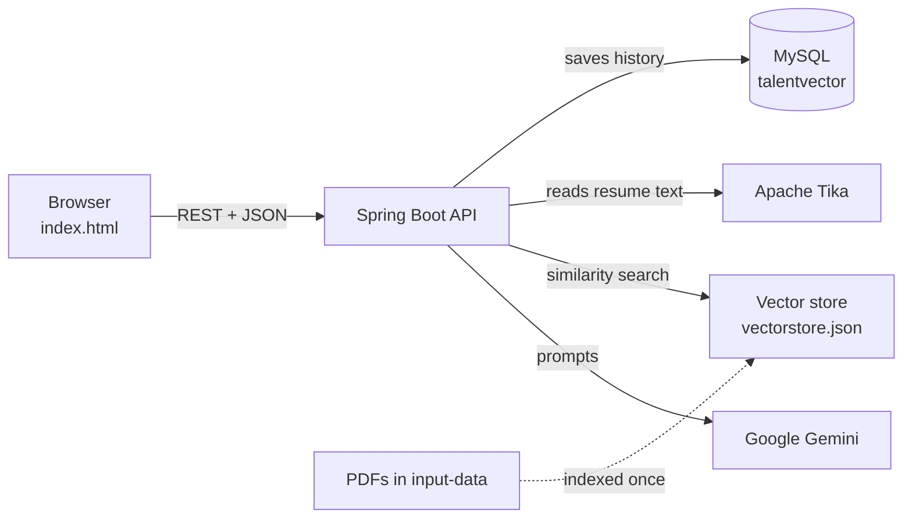

# MultiDime

An AI backend with a web page on top. It answers questions **from your own PDFs**, reviews resumes, matches a resume to a job description with an ATS score, and keeps a history of everything in MySQL.

The AI is Google Gemini, called through Spring AI. The backend is Spring Boot. The web page is a single HTML file with no build step.

## What it does

| Feature | What you get |
|---|---|
| **Ask AI** | A plain chat with Gemini. |
| **Ask my PDFs** (RAG) | Answers taken only from the PDFs in `input-data`. If the answer isn't in them, it says so. |
| **Resume review** | Upload a resume to get a rating out of 10, the skills found and three ways to improve it. |
| **Job match** (ATS) | Upload a resume and paste a job description to get a score out of 100, matched keywords, missing keywords and a summary. |
| **History** | Every question and every resume result is saved in MySQL and listed on the History page. |

## Screenshots

Add your own screenshots to `docs/screenshots/` using these file names and they will show up here.

| | |
|---|---|
|  |  |
|  |  |
|  |  |

## How it fits together



**How a question to "Ask my PDFs" is answered**

1. The question is turned into an embedding (a list of numbers) by Gemini.
2. The vector store finds the 5 PDF passages closest to it.
3. Those passages are added to the prompt, with the rule "answer only from this context".
4. Gemini answers, and the question and answer are saved to MySQL.

**How the PDFs get indexed**

On the first start, `RagIndexer` reads the PDFs, cuts them into chunks and embeds them in small batches with a pause between batches, so it fits the free Gemini quota. Progress is saved after every batch, so if the app stops or the quota runs out, the next start continues from where it stopped. It runs in the background, so the app is usable straight away. When it finishes, the result is saved to `vectorstore.json` and later starts just load that file.

## Tech stack

- Java 21, Spring Boot 3.5, Spring AI 1.0
- Google Gemini (chat and embeddings), through its OpenAI-compatible endpoint
- Spring Data JPA with MySQL 8
- Apache Tika for reading PDF, Word and text files
- Spring AI `SimpleVectorStore` (a JSON file) for the PDF index
- springdoc-openapi (Swagger UI) for the API documentation
- JUnit 5, Mockito and MockMvc for tests
- Plain HTML, CSS and JavaScript for the front end

## Project structure

```
src/main/java/com/multidime
├── App.java
├── advisor/LoggingAdvisor.java          logs each request and response sent to the AI
├── config/
│   ├── ChatConfig.java                  chat client, RAG advisor and vector store
│   ├── OpenApiConfig.java               title and description of the Swagger page
│   └── WebConfig.java                   CORS
├── controller/
│   ├── ChatController.java              /api/chat, /ask, /rag/chat, /analyze, /ats-check, /health
│   ├── HistoryController.java           /api/history/...
│   ├── ChatRequest.java                 JSON body for the chat endpoints
│   └── ApiExceptionHandler.java         turns framework errors into {"error": "..."}
├── model/                               JPA entities: ChatMessage, ResumeResult
├── repository/                          Spring Data repositories
├── service/HistoryService.java          saves and reads history
├── rag/RagIndexer.java                  paced, resumable PDF indexing
└── validation/                          InputValidator, UnreadableFileException

src/main/resources
├── static/index.html                    the web page
├── input-data/                          the PDFs to answer from
├── output-data/vectorstore.json         the saved index
└── application.properties

src/test/java/com/multidime                 unit tests that need no Gemini and no MySQL
```

## Getting started

### You need

- JDK 21 or newer
- MySQL 8 (MySQL Workbench is handy for looking at the data)
- A Gemini API key from [Google AI Studio](https://aistudio.google.com/apikey)

### 1. Create the database

```sql
CREATE DATABASE multidime CHARACTER SET utf8mb4 COLLATE utf8mb4_unicode_ci;
```

The tables are created automatically on the first start.

### 2. Set two environment variables

On Windows (PowerShell), then close and reopen your terminal and editor:

```powershell
setx GEMINI_API_KEY "your-gemini-key"
setx MYSQL_PASSWORD "your-mysql-root-password"
```

On macOS or Linux, use `export GEMINI_API_KEY=...` and `export MYSQL_PASSWORD=...`.

### 3. Run it

```powershell
.\mvnw.cmd spring-boot:run
```

On macOS or Linux use `./mvnw spring-boot:run`.

### 4. Open it

| What | Address |
|---|---|
| The web page | http://localhost:8080/ |
| API documentation (Swagger UI) | http://localhost:8080/swagger-ui.html |
| Health check | http://localhost:8080/api/health |

On the very first start the PDFs are indexed in the background. Watch the console for `Indexing complete`. Until then, "Ask my PDFs" can only use the part that is already indexed.

## API

Every error is JSON in the form `{"error": "message"}`.

| Method and path | Sends | Returns |
|---|---|---|
| `GET /api/health` | nothing | `{"status": "UP"}` |
| `POST /api/chat` | `{"message": "..."}` | `{"response": "..."}` |
| `GET /api/ask?question=...` | a query parameter | `{"response": "..."}` |
| `POST /api/rag/chat` | `{"message": "..."}` | `{"response": "..."}` |
| `POST /api/analyze` | form data: `file` | `{"analysis": "..."}` |
| `POST /api/ats-check` | form data: `file`, `jd` | `{"atsReport": "..."}` |
| `GET /api/history/chats?limit=20` | nothing | a list of saved questions and answers |
| `GET /api/history/resumes?limit=20` | nothing | a list of saved resume results |

Example:

```powershell
Invoke-RestMethod -Uri "http://localhost:8080/api/chat" -Method POST -ContentType "application/json" -Body '{"message": "What is Spring Boot?"}'
```

### Input rules

| Input | Rule | If broken |
|---|---|---|
| Message or question | 1 to 4000 characters | 400 |
| Job description | 1 to 10000 characters | 400 |
| Resume file | PDF, `.doc`, `.docx`, `.txt` or `.rtf`, at most 5 MB, with readable text | 400 (413 if over the server limit) |

## Configuration

Set these in `src/main/resources/application.properties`.

| Setting | Default | Meaning |
|---|---|---|
| `spring.ai.openai.chat.options.model` | see the file | The Gemini chat model. Google retires model names from time to time, so update it if you get a 404. |
| `app.rag.max-chunks-per-file` | `150` | Most chunks indexed from one PDF. `0` means all of it. |
| `app.rag.batch-size` | `10` | Chunks embedded before each pause. |
| `app.rag.pause-seconds` | `25` | Pause between batches, to stay inside the free quota. |
| `app.rag.top-k` | `5` | How many PDF passages are given to the AI for each question. |
| `app.rag.similarity-threshold` | `0.5` | How close a passage must be to count. |
| `spring.servlet.multipart.max-file-size` | `5MB` | Largest upload. |

**To rebuild the PDF index** (after adding a PDF or changing `app.rag.max-chunks-per-file`), delete `src/main/resources/output-data/vectorstore.json` and start the app again.

## Tests

```powershell
.\mvnw.cmd test
```

There are more than 60 unit tests. They replace Gemini and the database with mocks, so they need neither an API key nor MySQL and use no quota. They cover every endpoint, input validation, error responses, saving to history, and the indexing helpers.

## Known limits

- The Gemini free tier has small daily limits. When they run out, the AI endpoints return an error that mentions the rate limit.
- Chat answers are not remembered between messages. Each message is answered on its own.
- There are no user accounts, so the history is shared by everyone who uses the app.
- The index is a JSON file, which is fine for a few hundred chunks. A real vector database would be the next step for much more data.

## Ideas for next steps

- User accounts with login, and history for each user
- Docker and Docker Compose, to start the app and MySQL with one command
- Showing which PDF and page each answer came from

## Credits

Original project by **Vaishnavi Rathore**.
Extended with the web page, MySQL history, resumable PDF indexing, input validation, API documentation and tests by **Vaishnavi Rathore**.
